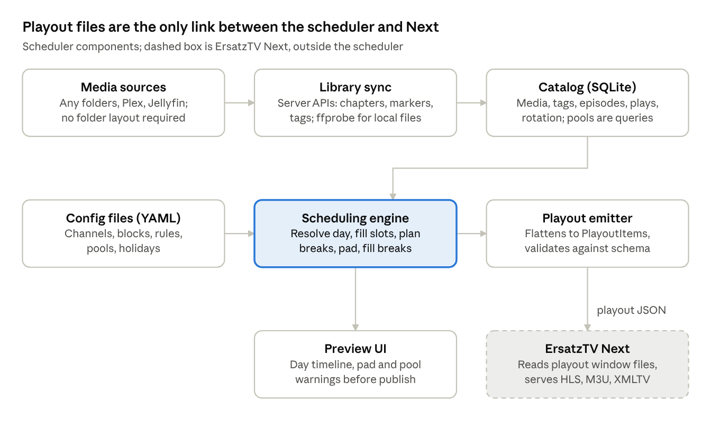
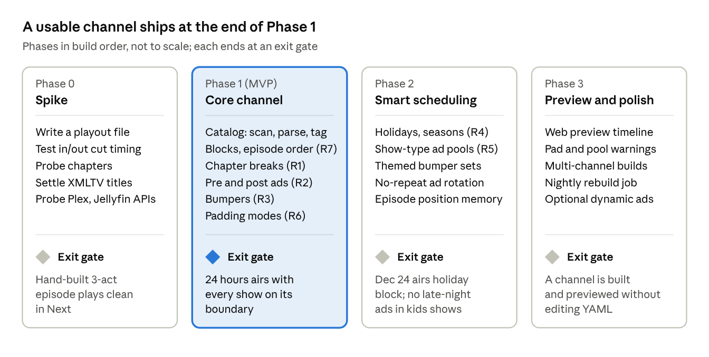

# ErsatzTV Next Scheduler: Planning Doc

Oct 10, 2026 · Aaron

Live version: https://claude.ai/code/artifact/4bef800d-3e67-4824-9db3-f34005d0508d

## Overview and goals

The scheduler is a standalone tool that builds broadcast-style playouts (shows, commercial breaks, bumpers) and hands them to ErsatzTV Next to stream. Next handles playback and transcoding. The scheduler decides what airs, when, and with which breaks.

**Goals**

- Make a channel feel like real TV: breaks inside shows at chapter marks, ads and bumpers around shows.
- Schedule by time of day, time of year, and holidays without hand-editing every day.
- Match commercials to the show's audience (kids, sitcom, anime, late night).
- Land every show on a clean boundary (top or bottom of the hour, or the next 5 or 10 minutes) by padding with filler.
- Work directly with existing Plex and Jellyfin libraries, using their chapters, markers, ratings, and tags, as well as plain local folders.

**Non-goals for v1**

- Live streaming, transcoding, or playback. Next owns that.
- Media library management such as scanning, metadata scraping, or artwork. The scheduler reads existing Plex, Jellyfin, or folder libraries.
- Multi-user permissions or a hosted service.

## ErsatzTV Next: the integration surface

The scheduler's only output is playout JSON files written into each channel's playout folder. [ErsatzTV Next](https://github.com/ErsatzTV/next) is a Rust streaming engine that explicitly leaves scheduling and playout creation to outside tools. It reads playout files and streams them as HLS, M3U, and XMLTV.

**What Next gives the scheduler to work with** (playout schema 0.0.5, the newest the released Next 0.2.0 accepts; engines take any version at or below their own):

| Capability | Schema detail | Why the scheduler cares |
| --- | --- | --- |
| Time-windowed playout files | Files named `{start}_{finish}.json` in compact ISO 8601, inside the folder set by `channel.json` | The scheduler writes one file per window, for example one per day, and rolls forward. |
| Ordered items with exact times | Each item has `id`, `start`, `finish` in RFC 3339 | Every show segment, ad, and bumper is its own item with a computed time. |
| Clip a file to a segment | `in_point_ms` and `out_point_ms` on local and HTTP sources | Chapter-based ad breaks need no re-encoding. One episode becomes several items, one per act. |
| Skip probing | `probe_hint` on any source | The scheduler already probed durations, so Next can skip ffprobe at playback. |
| Synthetic filler | `lavfi` sources, such as `color` or `anullsrc` | Last-resort padding: a slate or black frame when no filler fits the gap. |
| Late-bound items | `dynamic` source fetches a `PlayoutItem` over HTTP at playback | Optional later phase: pick ads at air time instead of at build time. |
| Graphics layers | `watermark` and `graphics` with periodic timing | Network bug on shows, suppressed during ads. |
| Gap fallback | `fallback` in `channel.json` | Safety net if a playout window is missing. The scheduler should never rely on it. |

**Key constraints**

- Playout items have no title or description field. Guide data is a separate XMLTV file per channel that the scheduler also writes.
- Each file declares a `version`, and Next rejects versions it does not understand. The scheduler must pin a schema version and track Next's changelog.
- The maintainers will not take scheduling feature requests, so everything in this doc lives in the scheduler.

Sources: [README](https://github.com/ErsatzTV/next), [schema/playout.json](https://github.com/ErsatzTV/next/blob/main/schema/playout.json), [schema/channel\_config.json](https://github.com/ErsatzTV/next/blob/main/schema/channel_config.json), [example playout](https://github.com/ErsatzTV/next/blob/main/examples/playout/playout.json).

## Plex and Jellyfin libraries

Plex and Jellyfin are first-class media sources alongside local folders. The scheduler reads their metadata over each server's API and never edits their libraries. Next plays each file by direct path when it can see the disk, and streams from the server over HTTP when it can't.

### What the scheduler reads from each source

| Need | Plex | Jellyfin | Local folder |
| --- | --- | --- | --- |
| Item list and stable ID | Library section items, keyed by `ratingKey` | `/Items` with `ParentId` and `Recursive=true`, keyed by `Id` | Folder scan, keyed by path |
| Duration | Media `duration` in ms | `RunTimeTicks`, in 100 ns ticks | ffprobe |
| File path | Part `file` | `Path` on the item or its MediaSource | The path itself |
| Chapters | `Chapter` elements with `startTimeOffset` in ms | `Chapters[].StartPositionTicks` | `ffprobe -show_chapters` |
| Intro, credits, ad markers | `Marker` elements typed intro, credits, or commercial | Media segments, server 10.10 and later: Intro, Outro, Recap, Preview, Commercial | None |
| Show-type signals | `contentRating`, genres, labels, collections | `OfficialRating`, genres, tags, collections | Folder names or a sidecar YAML file |
| HTTP stream fallback | Part key URL with the Plex token | Static stream URL with an API key | Not needed |

Units differ by source, so the sync converts every time to integer milliseconds before it reaches the catalog. Plex's exact query flags for chapters and markers should be confirmed against a live server in Phase 0.

### How Next plays the files

1. **Direct path, the default.** Path mapping rules rewrite the server's path prefix to the path Next sees, such as Plex's `/data/tv` to `/mnt/nas/tv`. Legacy ErsatzTV uses the same approach for both servers. The playout uses a local source with in and out points and a probe hint. This gives the best quality and puts no load on Plex or Jellyfin.
2. **HTTP stream, the fallback.** For setups where Next can't mount the media, the item uses an HTTP source pointing at the server's original-file stream, not a transcode. Next supports in and out points on HTTP sources, so chapter breaks still work. Tokens go in a header placeholder so they never sit in playout files in plain text.

The mode is set per source with a per-library override. Every sync checks that each mapped path exists and lists any that don't before a build can publish.

### Markers make better breaks

- **Classic break spots.** A break can follow the intro marker, which matches the cold open, theme, break pattern of real TV. Another can land right before the credits marker.
- **Strip recorded ads.** DVR recordings with commercial markers can have the original ads cut out with in and out points, then refilled with the channel's own ads.
- **Cut-point priority.** Chapter boundaries come first, then marker and segment edges, then even spacing.

### Show types from existing metadata

Show types are derived from metadata users already maintain, with simple rules that can be overridden.

| Show type | Default rule | Override |
| --- | --- | --- |
| Kids | Rating TV-Y, TV-Y7, TV-G, or G, or genre Children or Kids | Label or tag `etv:kids` |
| Anime | Genre Anime, or the show sits in an anime library | `etv:anime` |
| Sitcom | Genre Comedy and episode runtime 30 minutes or under | `etv:sitcom` |
| Late night | Rating TV-MA, R, or NC-17 | `etv:latenight` |

A Plex label or Jellyfin tag beats every rule, so users tag shows in the tool they already use. Ads and bumpers can live in a separate Plex or Jellyfin library, such as an Other Videos library, or in local folders. Their tags come from labels, tags, or folder names.

Sources: [Jellyfin media segments](https://jellyfin.org/docs/general/server/metadata/media-segments), [Jellyfin ChapterInfo model](https://typescript-sdk.jellyfin.org/interfaces/generated-client.ChapterInfo.html), [Jellyfin MediaSegmentDto model](https://typescript-sdk.jellyfin.org/interfaces/generated-client.MediaSegmentDto.html), [Plex Media Server API](https://developer.plex.tv/pms/), [Plex marker format in the Infuse forum](https://community.firecore.com/t/add-support-for-plex-skip-intro/19936?page=3), [legacy ErsatzTV Jellyfin integration](https://mintlify.wiki/ErsatzTV/legacy/integrations/jellyfin), [legacy ErsatzTV Plex integration](https://mintlify.wiki/ErsatzTV/legacy/integrations/plex).

## Media catalog: a database instead of folders

Decided Oct 10, 2026: the catalog is the organizing model, not a cache behind folders. A file can live anywhere, belongs to as many pools as its facts allow, and is selected by query. Folders become an optional hint.

**What the scan records.** One SQLite file, built by a scan command over any roots the user names. Each file is probed once and re-probed only when its size or modified time changes.

| Table | Holds | Filled from |
| --- | --- | --- |
| media\_items | path, kind (episode, movie, commercial, bumper, filler), duration\_ms, codec facts, source, external\_id, probed\_at | Scan plus ffprobe, or the Plex and Jellyfin APIs |
| chapters, markers | start and end per chapter; intro, credits, and commercial markers | ffprobe, Plex, Jellyfin |
| episodes | show, season, episode number, title, original air date | Filename parsing, container tags, server metadata |
| tags | free labels per item such as taco-bell, 1991, psa, kids | Rules on scan, plus manual tag commands |
| plays | item, channel, aired\_at, slot context | Every build |
| rotation | per show and channel: order mode, position, current shuffle cycle | Every build |

**Where facts come from, highest priority first.** Manual tags always win. Then container tags, since ffprobe returns title, show, episode, and date when the ripping tool wrote them. Then filename patterns such as `S04E04`, four-digit years, `1990-10-15` dates, and words like Commercial, PSA, and Promo. Folder names last, as a weak hint. The scan ends with a report of files it could not classify.

**Pools are saved queries.** An ad pool is a filter expression instead of a directory, for example `kind = commercial AND year BETWEEN 1988 AND 1994 AND NOT tag:late-night`. A bumper set is `kind = bumper AND tag:station-id`. The filler takes the pool's candidates, drops anything in `plays` inside the cooldown window, then fits the break.

**Era matching.** Because both the episode and the commercial carry a year, a pool can be relative: commercials from within three years of the airing episode's date. A 1991 TNG episode and a 1995 Simpsons episode pull different spots from the same library with no sorting.

**Costs.** Filename parsing is heuristic, so the scan report and a quick tag command matter from day one. The database is the thing to back up, not just a cache. Changing a file's path moves it, not its identity, because items are keyed by a content hash of the first and last megabyte plus size.

## Feature requirements

Seven capabilities define v1. Each one names its acceptance test so the engine can be checked against it.

| # | Requirement | Behavior | Acceptance test |
| --- | --- | --- | --- |
| R1 | Mid-show commercial breaks at chapter markers | Read chapter markers from each episode. Split the episode at selected chapter boundaries and insert a break at each. Respect a max breaks-per-show and a minimum act length so breaks don't land 30 seconds apart. Episodes without chapters fall back to evenly spaced breaks or none, per channel setting. | A 22-minute episode with 4 chapters airs as 4 acts with 3 breaks, and the acts play back to back with no lost frames. |
| R2 | Commercials before and after shows | Optional pre-roll and post-roll ad breaks per show, block, or channel. | A show with pre-roll on airs ads, then the show. |
| R3 | Bumpers before and after shows | Intro bumpers ("Now back to...", "Up next") and outro bumpers ("We'll be right back", station ID). Bumpers can also bracket mid-show breaks. Bumpers are chosen by show, show type, channel, or holiday theme. | A break reads: outro bumper, ads, intro bumper, next act. |
| R4 | Schedule by time of day, time of year, or holiday | Day-parts such as morning cartoons, prime time, and late night. Seasonal ranges such as summer or the school year. Holidays as fixed dates, like Dec 25, or rules, like the fourth Thursday of November. The most specific matching rule wins. | On Dec 24 the 8pm slot airs the Christmas block. The rest of December airs the normal prime-time block. |
| R5 | Commercials by show type | Show types such as kids, sitcom, anime, and late night each map to one or more ad pools. Ads carry tags too, so a kids show never pulls a late-night ad. | Across a week of generated playouts, no ad tagged late-night appears in a kids show. |
| R6 | Pad to minute boundaries | A slot's end snaps to the next 30 or 60 minutes, or to the next 5 or 10 minutes. The gap is filled with ads, bumpers, and filler spread across the show's breaks. | A 22:10 episode in a 30-minute slot gets 7:50 of breaks and the next show starts at :00 or :30 exactly. |
| R7 | Configurable episode order | Per show and channel the user picks chronological or shuffle. Chronological follows original air date, falling back to season and episode number, and wraps to the start when the show runs out. Shuffle draws without replacement: every episode airs once before any repeats, then a new cycle is shuffled. Position survives rebuilds and restarts. | A 178-episode show in shuffle mode airs 178 distinct episodes before the first repeat. Switching to chronological mid-run resumes from the next unaired episode in date order. |

**Supporting requirements**

- **Rotation and no repeats:** Shuffle ads within a pool and avoid the same ad twice in one break or back to back. Rotate episodes in order or shuffled, and remember position across rebuilds.
- **Preview before publish:** Show the generated day as a timeline before writing files.
- **Deterministic builds:** The same inputs and seed produce the same playout, which makes bugs reproducible.
- **Guide data:** Show-level entries span the whole slot, including its breaks, so the guide reads like real TV.

## Core concepts and data model

Everything the engine schedules is a media item with tags. Rules decide which tagged items fill which slots on which days.

| Entity | What it is | Key fields |
| --- | --- | --- |
| MediaItem | One playable file: episode, movie, ad, bumper, or filler | content\_hash, path, kind, duration\_ms, chapters\[\], markers\[\], tags\[\], year, probe data (codecs, streams), source, external\_id |
| Show | A series or collection of MediaItems | title, show\_type, order mode (chronological or shuffle), per-channel rotation state: next position for chronological, remaining episode list for the current shuffle cycle |
| ShowType | The audience category | name (kids, sitcom, anime, late night), default ad pools, default bumper sets |
| AdPool | A weighted set of commercials | name, filter query over the catalog (kind, tags, year range, or relative era), weight per item, cooldown minutes |
| BumperSet | Bumpers grouped by role | role (intro, outro, break-in, break-out, station ID), tag filter, theme |
| FillerPool | Short clips used to close the last few seconds | items, min and max length, lavfi slate as last resort |
| BreakPolicy | How a show's breaks are shaped | use chapters (yes/no), max mid-breaks, min act length, pre-roll, post-roll, bumper bracketing |
| PaddingPolicy | How the slot end snaps | mode (30, 60, next 5, next 10, none), max pad, min pad |
| Block | A reusable run of slots, like "Saturday morning cartoons" | slots\[\] with show or show-type picks, BreakPolicy and PaddingPolicy overrides |
| Calendar rule | When a block airs | channel, days of week, time range, date range or season, holiday ref, priority |
| Holiday | A named date | fixed date (Dec 25), rule (4th Thu Nov), or offset (Easter + 0), plus lead-in days |
| Channel | One ErsatzTV Next channel | number, playout folder path, default policies, graphics (network bug), build horizon |
| MediaSource | A Plex server, Jellyfin server, or local folder root | kind, URL, token reference, enabled libraries, path mapping rules, playback mode (direct path or HTTP), last sync time |
| Play | One airing of one item, recorded by every build | item, channel, aired\_at, break or slot it filled; drives cooldowns, no-repeat rules, and shuffle cycles |

**Policy inheritance:** Channel defaults, then ShowType, then Show, then Block slot. The most specific setting wins. A single setting like "late-night shows get 4 breaks" lives on the ShowType, not on every show.

**Tags do the matching.** A MediaItem's tags, such as `kids`, `christmas`, or `90s`, drive pool membership. Adding a new ad means dropping a file in a folder with a tag, not editing schedules.

## Scheduling engine design

The engine builds a channel one day at a time in five passes, then writes a playout file. Each pass only adds detail, so a failure points at one stage.

1. **Resolve the day.** For each channel and date, collect calendar rules that match: holiday, then date range or season, then day of week, then the channel default. Higher priority wins per time range, and the result is a list of Blocks with start times.
2. **Fill slots.** For each slot in each Block, pick the show or episode. Pick by the show's order mode: the next episode by air date in chronological mode, or the next draw from the current no-repeat cycle in shuffle mode. Advance rotation state and apply show-type filters. Record the episode's content length.
3. **Plan breaks.** Turn each episode into acts. Choose cut points from chapter markers that respect min act length and max breaks. Without chapters, fall back per BreakPolicy. Add pre-roll and post-roll break positions.
4. **Compute the pad.** Snap the slot end to the PaddingPolicy boundary and get the total break time to fill. Split it across break positions, weighted so mid-show breaks get more than pre-roll.
5. **Fill breaks.** For each break, wrap with bumpers, then pick ads from the show type's pools until the break's budget is nearly used. Close any remainder with filler, then a lavfi slate for the last frames.

Then the emitter flattens everything into PlayoutItems with exact start and finish times and writes the window file.

### Padding algorithm

The slot end is the content end rounded up to the next boundary. If that leaves less than the minimum pad, it jumps one more boundary.

```latex
\text{end} = \left\lceil \frac{t_{start} + d_{content} + p_{min}}{B} \right\rceil \cdot B, \qquad \text{pad} = \text{end} - t_{start} - d_{content}
```

Here B is the boundary size: 30 or 60 minutes for slot modes, and 5 or 10 minutes for the next-5 and next-10 modes. B is measured on the wall clock, so a show starting at 8:03 with next-10 rounding snaps to 8:10 multiples.

**Worked example:** A 22:10 sitcom starts at 8:00 in a 30-minute slot with a 2-minute minimum pad. The end is 8:30 and the pad is 7:50. With 3 mid-breaks and no pre-roll, each break gets about 2:37 of ads and bumpers.

**Filling a break budget** is a small knapsack problem. Ads come in fixed lengths of 15, 30, and 60 seconds, so a greedy pick of the longest ad that fits, followed by filler, usually lands within a second. Any remaining frames go to a slate. The last break absorbs rounding error so the next show starts on the exact millisecond.

**Guardrails:** A max pad cap stops a 31-minute episode from forcing 29 minutes of ads in a 60-minute slot. When the cap is hit, the engine either drops to the next smaller mode or flags the slot in preview.

## Architecture and tech choices

The scheduler is a single local service with a CLI first and a web preview second. It touches Next only by writing files into each channel's playout folder.



The scanner fills the catalog once and refreshes on change. The engine reads the catalog and config, the preview shows the result, and the emitter writes validated files for Next.

| Decision | Recommendation | Reason |
| --- | --- | --- |
| Language | C# / .NET 10 | Decided Oct 10, 2026: C# on .NET 10. It ships as self-contained single-file binaries for Windows, Linux, and macOS plus a Docker image, the same way Next and legacy ErsatzTV ship. Legacy ErsatzTV is C#, so its community and its Plex and Jellyfin code are familiar. Rust was the first pick but needs a toolchain install and slows the web UI later. |
| Chapter and duration extraction | `ffprobe -show_chapters -show_format -show_streams` | Used for local folders and for Plex or Jellyfin items missing chapters. Plex and Jellyfin items take chapters and markers from the server API first. Results are cached in the catalog and passed to Next as a probe hint. |
| Config format | YAML files in a folder | Readable, diffable, and easy to keep in git. The web UI edits the same files later. |
| State storage | SQLite | The catalog is the organizing model: media facts, tags, parsed episode data, plays, and rotation state. Pools are queries over it. One file, easy to back up, no server to run. |
| Build trigger | Nightly job plus on-demand rebuild | Keeps a rolling horizon of playout files, such as 3 days ahead. |
| Output | One playout file per channel per day, named per the schema | Matches Next's lookup by current time. Writing to a temp name and renaming keeps Next from reading a half-written file. |

## Phased roadmap

Phase 1 delivers a watchable channel with every v1 break feature except calendar rules and show-type ad pools. Phase 0 exists to retire the two riskiest unknowns first: frame-accurate cuts and guide titles.



No dates are set yet. Each phase starts only when the previous exit gate passes.

## Open questions and risks

**Open questions**

- [x] Closed Oct 10, 2026: Next reads guide data from one XMLTV file per channel, named by the channel's tvg\_id, in the lineup's xmltv folder. It copies the programme elements as-is, so the scheduler writes titles, descriptions, categories, and episode numbers itself.
- [x] Closed Oct 10, 2026: Next expands placeholder tokens in HTTP source URLs and headers from environment variables at playback. Plex and Jellyfin tokens for HTTP playback go in Next's environment, never in playout files.
- [ ] How much overlap with legacy ErsatzTV is acceptable? Legacy ErsatzTV already has filler and mid-roll features. Decide whether this tool replaces it or targets users who run Next standalone.
- [ ] How long a window per playout file: one day, or a rolling 48 hours? This affects how quickly rule edits reach the air.
- [ ] Should ad picks happen at build time, or at air time through a dynamic source? Build time is simpler and previewable.
- [ ] Which time zone and DST rules apply when a slot crosses a daylight-saving change?

**Risks**

| Risk | Impact | Mitigation |
| --- | --- | --- |
| Playout schema changes between Next releases | Generated files rejected, channel falls back to slate | Pin the schema version, validate every file against the JSON schema in CI, watch the changelog |
| Chapter markers missing or wrong in many files | Breaks land mid-sentence or not at all | Fallback break spacing, a per-file override, and a library report of files without chapters |
| Not enough ads in a pool | Same ad repeats, channel feels fake | Pool size warnings in preview and cross-pool fallback by tag |
| Frame-accurate cuts at in and out points | A few frames repeat or drop at each act boundary | Test seek accuracy early in Phase 1, prefer chapter times on keyframes |
| Padding math drifts by milliseconds per item | Shows slowly start late | Compute all times as integer milliseconds from the slot start, never by summing floats |
| Plex or Jellyfin paths don't match what Next sees | Items fail at playback and the channel shows the fallback slate | Path mapping rules, a path check on every sync, and publish blocked until every scheduled file resolves |
| Plex or Jellyfin API changes, or Plex chapter and marker fields differ from what forums show | Sync breaks or misses chapters | One adapter per server behind a shared interface, contract tests against recorded responses, ffprobe fallback for chapters |
| HTTP playback depends on Plex or Jellyfin being up | A server restart takes the channel off air | Prefer direct path, and warn in preview when a channel relies on HTTP |
